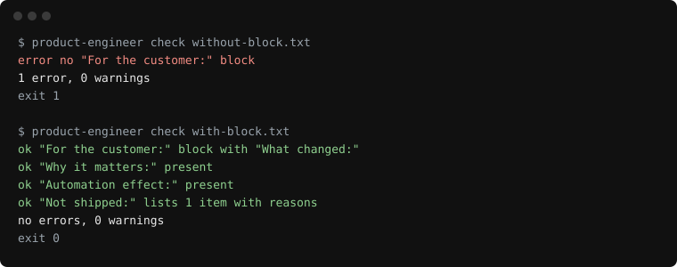

# My coding agent's commit message says it added tests, and the change has none.

product-engineer is an agent skill and command-line checker that makes AI coding agents explain each commit and pull request in plain language, and warns when the message contradicts the diff.

Skills for the agents in your project (Claude Code, Codex, Cursor and the rest):

```
npx skills add Bubblegunn/product-engineer
```

The same skills as a Claude Code plugin (Claude Code 2.1.275 or later):

```
/plugin install product-engineer --marketplace Bubblegunn/product-engineer
```

The command-line checker, which needs Node 22 or newer:

```
npx product-engineer check msg.txt --diff
```

`msg.txt` holds the commit message and the change is what you staged with `git add`. For a pull request: `npx product-engineer check --pr 12 --diff main...HEAD` (needs `gh`).


The recording is real output, made with [vhs](https://github.com/charmbracelet/vhs) from [`docs/demo-diff.tape`](docs/demo-diff.tape). `--diff` prints warnings and exits 0, so it never blocks a commit by itself. It checks four kinds of mismatch (listed [below](#does-the-message-match-the-change)) and it cannot read operation verbs, so "added" against "removed" goes unnoticed. On 59 real commits from this repository's own history, run at `25dcce7`, it raised 0 false alarms ([`evals/baseline/RESULTS.md`](evals/baseline/RESULTS.md)).

English | [Türkçe](README.tr.md) | [简体中文](README.zh-CN.md)

<p>
  
  
  
  
  <a href="https://github.com/marketplace/actions/product-engineer-check"></a>
</p>

## Does the skill part work?

It depends on the model. The skill is four skills, each a SKILL.md with the main one also carrying reference files, that tell an agent to write a plain-language "For the customer" block in each commit, say what it observed, and name what it did not build. It was run on the same eight small tasks, bare and with the skill, on three models. The row below is the commit carrying the block.

| model | without the skill | with the skill | reading |
|---|---|---|---|
| claude-opus-5 | 0 / 8 | 8 / 8 | not computed, one run per task |
| claude-sonnet-5-5 | 0 / 24 | 13 / 24 | worked |
| claude-haiku-4-5 | 0 / 24 | 0 / 24 | no clear effect |

On claude-haiku-4-5 all five measures read "no clear effect". The reading rule was written before any data existed ([`evals/MODELS-DESIGN.md`](evals/MODELS-DESIGN.md)). The checks are regular expressions over the agent's own words, so they reward saying the right thing ([`evals/RESULTS.md`](evals/RESULTS.md) lists what they miss). The skill also costs more on the largest model: $0.45 per run bare and $0.63 with the skill on claude-opus-5. Every number, cost and transcript: [`evals/RESULTS-models.md`](evals/RESULTS-models.md).

## How this differs

The checker was last run on the same inputs as other tools on 2026-10-21 (product-engineer 0.7.0), the skill on 2026-10-20 (0.6.2). The generated tables, the pinned competitor versions and the commands to repeat them are in [`docs/COMPARISON.md`](docs/COMPARISON.md). Rows where product-engineer loses are in that file. The tables here show only rows it wins or ties.

**Against commitlint 21.2.4**, which checks the Conventional Commits shape, which product-engineer does not. They run together: product-engineer ships a commitlint plugin (`product-engineer/commitlint`). Same message text given to both:

| message | product-engineer | commitlint |
|---|---|---|
| A full customer block | passed | passed |
| No customer block | flagged | passed |
| Passing tests offered as the evidence | flagged | passed |
| A number with no method or scope | flagged | passed |
| Says tests were added; the change has none | flagged | cannot |

"cannot" means commitlint is never shown the change. Page: [`docs/vs-commitlint.md`](docs/vs-commitlint.md).

**Against two other agent skills**, on the eight tasks, claude-opus-5, one run per task (commits in the first row: how many of eight carried the block). The measures were written for product-engineer's own rules, so a skill that aims elsewhere scores low on them by design. [`verification-before-completion`](docs/vs-verification-before-completion.md) is from obra/superpowers (MIT); [`changelog-generator`](docs/vs-changelog-generator.md) is from ComposioHQ/awesome-claude-skills (no licence detected, run only):

| measure | product-engineer | verification-before-completion | changelog-generator |
|---|---|---|---|
| Commit carries the For-the-customer block | 8 / 8 | 0 / 8 | 0 / 8 |
| Final message reports an observation or says what it could not check | 7 / 8 | 0 / 8 | 0 / 8 |
| Final message names something deliberately not done | 5 / 8 | 0 / 8 | 1 / 8 |
| Every number in the final message has a method or scope next to it | 2 / 8 | 1 / 8 | 2 / 8 |
| Only the requested files changed (tests and documentation allowed) | 8 / 8 | 7 / 8 | 7 / 8 |

The headline feature of `changelog-generator`, writing a changelog from commits, was not measured. None of the eight tasks asks for one.

## Compared on the same tasks

The next comparison runs thirteen tasks on eight arms, three runs each: the bare model, product-engineer, and three directory competitors, each also run in a session where its skill is called by name. The method, the pinned competitor commits and the win rule are in [`docs/HEAD-TO-HEAD.md`](docs/HEAD-TO-HEAD.md).

## See it

The same commit, before:

```
fix(notifications): classify IsSystem events as idempotent and skip the badge increment
```

After:

```
fix(notifications): classify IsSystem events as idempotent and skip the badge increment

For the customer:
What changed: Things the system handles on its own no longer light up the phone or the menu badge; only items that need a person do.
Why it matters: The badge count means "something needs you" again, so people stop ignoring it.
Automation effect: Automatic housekeeping events are now fully handled without anyone looking at them.
```

The agent's report, before:

```
Done. All 42 tests pass.
```

After:

```
Watched it in staging logs: 3 of 3 webhook retries logged, final failure recorded with the booking id.
Could not check: production, no deploy yet.
Not shipped:
- Dead-letter queue: three retries cover every failure in 90 days of logs.
```

The check, on a message without the block and then with it (the two fixtures are in
[`test/fixtures/`](test/fixtures/), so the picture can be reproduced from the command):



A longer pair, unedited, from the evaluation: [`docs/examples.md`](docs/examples.md).

One real defect in a public repository, fixed twice by the same model on the same commit,
with the skill and without, both commit messages quoted whole:
[`docs/case-study.md`](docs/case-study.md).

## Install

```
npx skills add Bubblegunn/product-engineer
```

In Claude Code you can install it as a plugin instead (Claude Code 2.1.275 or later):

```
/plugin install product-engineer --marketplace Bubblegunn/product-engineer
```

That places the skills for the agents in your project (Claude Code, Codex, Cursor, Copilot,
Gemini CLI and the rest). Where each file lands, the Claude Code plugin commands, the git
hook and the CI action are in [`docs/install.md`](docs/install.md); Cursor as a rule file
rather than a skill is in [`docs/cursor.md`](docs/cursor.md).

The skills are text files and need nothing installed. The `product-engineer` command (`check`,
`doctor`, the pre-commit entry) needs Node 22 or newer; the commit-msg hook itself is POSIX sh.

## What the diff check costs

`--diff` fires only when it can prove a mismatch, so the question that matters is how often
it is wrong about a message somebody actually wrote. `npm run baseline` answers it on the
history of whatever repository you run it in: it mutates real commits so each message
contradicts its own diff, asks whether the checker notices, and writes
[`evals/baseline/RESULTS.md`](evals/baseline/RESULTS.md). CI reruns it on every push and fails
on a false alarm, on a reachable kind going uncaught, or on the unreachable kind being caught.

Run on this repository at `25dcce7`: 64 non-merge commits with file changes, 59 of them scored:

| measure | value |
|---|---:|
| false alarms on real messages | 0 |
| specificity | 100% |
| recall, the four kinds any check can reach | 100% |
| recall, `operation` | 0% |

The counts move as the history grows, which is why the run is named. Rerun it and you get
your own numbers, on your own repository.

That last row is in the corpus on purpose. No check reads operation verbs, so swapping
`added` for `removed` goes unnoticed, and a blind spot printed as a zero is one you can see.
Three kinds in the taxonomy this borrows from cannot be produced mechanically at all, because
they need someone to read what the code means; this reads a numstat.

Running it found three false alarms on real commits and all three are fixed, which is the
outcome the harness is for. It sits beside published numbers for models asked the same
question, and the design document explains why that is context rather than a comparison.

## The pack

| skill | what it is | install it when |
|---|---|---|
| [`product-engineer`](skills/product-engineer/SKILL.md) | the seven rules and the reference files | your agent writes code |
| [`customer-block`](skills/customer-block/SKILL.md) | rule 2 alone: the block, with two pairs | you only want the block in commits and pull requests |
| [`done-means-observed`](skills/done-means-observed/SKILL.md) | rule 3 alone: what was watched, what could not be checked | you only want honest completion reports |
| [`release-notes`](skills/release-notes/SKILL.md) | the rules for an agent that writes about software instead of writing it | release notes, changelogs, status updates |

The installer offers all four; pick what you need. `release-notes` leaves out docs-only, version-bump and test-only commits, lists under `Not in this release:` only what a reader would expect from the commits, and states the commit range on its first line. Agents that read instruction files
rather than skills (Cursor rules, Copilot instructions, Gemini, Cline, Kiro, Windsurf) get
the same seven rules from files generated out of `SKILL.md`; see
[`docs/install.md`](docs/install.md).

## The seven rules

1. Restate before building. One sentence of customer outcome, or one question.
2. For the customer, every time. What changed, why it matters, automation effect only if real.
3. Done means observed. Logs, data or a real device, or say what you could not check.
4. Build what was asked; name what you did not. A `Not shipped:` list with reasons.
5. No number without a count. Every figure has a command behind it and a scope.
6. Speak the stakeholder's language. A jargon-to-plain table ships with the skill.
7. Smallest change that moves the metric. One ledger line before any design.

Full text: [`skills/product-engineer/SKILL.md`](skills/product-engineer/SKILL.md). The
template, the five questions, the done checklist, the plain-language table and the
not-shipped format are in [`references/`](skills/product-engineer/references/).

## Check a message or a pull request

`product-engineer check` reads a commit message or PR description and reports whether it
carries the block and whether the block reads the way the skill asks: `What changed`, `Why it
matters`, an `Automation effect` line that is either meaningful or absent, a well-formed
`Not shipped:` list, numbers without a method next to them, and jargon from the plain-language
table used without an explanation.

```
node bin/check.mjs check .git/COMMIT_EDITMSG     # or: product-engineer check <file|->
node bin/check.mjs check --pr 12                 # the body through the GitHub API, or gh outside Actions
node bin/check.mjs check --pr 12 --kind pr       # a pull request: the block must start within the first 12 lines
node bin/check.mjs check --pr 12 --comment       # and one comment on the pull request, updated in place
node bin/check.mjs template                      # print an empty block to fill in (supports --lang)
node bin/check.mjs stubs                          # TODOs, empty bodies and decorative tests in the working tree and new files (the default)
node bin/check.mjs stubs --staged                # the same for the index only
node bin/check.mjs stubs --range HEAD~1..HEAD    # the same for a committed range
node bin/check.mjs stubs --json                  # the findings as one object: { count, findings }
node bin/check.mjs stubs --warn                  # report the findings but exit 0
product-engineer facts source.txt rewrite.txt  # a rewrite keeps every number; sentences stay short
product-engineer notes RELEASE_NOTES.md        # release notes carry no code names, commit prefixes or version-bump lines
```

`stubs` reads only the lines a change adds: the working tree against `HEAD` and new files by default. It flags TODO, FIXME and XXX markers, empty or placeholder function bodies, tests that assert nothing or compare an expression with itself, and newly skipped tests.

`notes` checks release notes for readers who do not read code: no commit prefixes, code identifiers or file names, no line about docs or a version bump, no unmeasured "faster" or percentage, and a version number only on the first line, which should name the range.

`facts` checks a plain-language rewrite against its source: the same numbers, the obligations carried over, legal phrases left in, rewrite sentences with no counterpart in the source (an added definition, intro or explanation), and sentences of at most 20 words on average and 35 at most. See [docs/check-reference.md](docs/check-reference.md).

With `--kind pr` the block must start within the first 12 lines, so a pull request opens with the part for the customer; a later block is a warning (`block-not-first`). The command prints a one-time star request on the first run in an interactive terminal. `--quiet` or `PRODUCT_ENGINEER_NO_STAR_HINT=1` turns it off, and it never appears in CI, in pipes, in agent sessions or in git hooks.

To configure git to use the block as your commit template (the `template` command was contributed by
[@Enard52](https://github.com/Enard52) in [#41](https://github.com/Bubblegunn/product-engineer/pull/41)):

```sh
product-engineer template > .gitmessage.txt
git config commit.template .gitmessage.txt
```


### Does the message match the change?

Everything above reads the message alone, so it can tell whether you said the right shapes.
It cannot tell whether what you said is true, and in 2026 that is the gap that hurts: the
description reads clean, the change is large, and the reviewer has no way to know which
sentences were checked. `--diff` reads the change itself and reports where the two disagree.

```
node bin/check.mjs check .git/COMMIT_EDITMSG --diff        # the staged change
node bin/check.mjs check --pr 12 --diff main...HEAD        # a branch
```

Four disagreements are reported, each naming what was counted:

| the message says | and the change shows | reported |
|---|---|---|
| tests were added | no test file gains a line | a warning, with the file counts |
| documentation only | a source or test file changed | a warning, naming the files |
| a file count | a different number of files | a warning, with both numbers |
| a path | it is in neither the change nor the repository | a warning, naming the path |

The fourth is the one worth having. A path that exists but is untouched is ordinary context
and is never reported; a path that is in neither place is a reference to a file that was
renamed, or never existed, which is a shape agent-written messages leave behind.

`--diff` also reports two things the message does not claim. A changed file whose name says it holds a credential, such as `.env` or a key file, is named. An added line that assigns a long value to a secret-like name is reported by file and line, and the value is never printed. A change whose lines fall into two or more unrelated groups, with no group holding 80 percent of them, gets a warning to split it.

A phrase inside backticks or quotation marks is being named, not asserted, so a message that
describes these checks does not trip them. That was the first thing the flag caught, on the
commit that added it.

Each check is conservative on purpose. A refactor claiming no behaviour change is not
checked against the source it touches, because that claim is usually true, and a number is
only read as a file count when its sentence also carries a verb of changing. Nothing here
reports an error, so a run that passed yesterday cannot fail today; without `--diff` the
output is byte-identical to before.

**Cited paths are checked too.** Every file path and GitHub Actions run URL the message cites is resolved against the working tree. A missing path or a line past the end of a file is a warning. The modes, and the reason a message that cites nothing still passes, are in [`docs/check-reference.md`](docs/check-reference.md#cited-paths).

Write the block in the language your team writes. English, Turkish, Japanese and Chinese
headings are accepted with no configuration, and a heading for any other language goes in
`.product-engineer.json`; the table and the format are in
[`skills/product-engineer/references/headings.md`](skills/product-engineer/references/headings.md),
and the commit-msg hook is generated from it so the two cannot disagree.

The block also gets a readability line (Flesch for English, Ateşman with `--lang tr`, and LIX), as information only. For scripts these formulas do not suit, the tool names the script, says it is not scoring and prints no number: [`docs/check-reference.md`](docs/check-reference.md#readability). Exit 1 on a missing block, 0 with `--warn`. `--format github` turns the findings into run annotations, and `--format json` prints them as one JSON object, `{ ok, findings: [{ level, code, message }], readability }`, for editors and dashboards. As a CI step
(needs `pull-requests: write` for the comment, see [`docs/install.md`](docs/install.md)):

```yaml
      - uses: Bubblegunn/product-engineer@v0
        # with: { warn: "true" }   # report instead of failing
```

## What it does not do

It runs no process and owns no workflow; it composes with spec, TDD and review skills. It
does not write product strategy. It enforces nothing unless you install the hook.

## Where it comes from

These are the rules Efe Genc worked by in four years in software engineering since
January 2022, as one of two founding engineers at Cendra, and as the sole author of a proactive
assistant: a commit convention
that explains every change to a non-technical reader, a definition of done that means
watching the thing behave, and the habit of writing down what was deliberately not built
([The feature I chose not to ship](https://efe-genc-portfolio.vercel.app/writing/the-feature-i-chose-not-to-ship/)).

## Contributing

Rule changes need one before/after pair and one eval task; see
[CONTRIBUTING.md](CONTRIBUTING.md), which also describes the one-command release. The [roadmap](ROADMAP.md) is short on purpose.
Translations and per-stack jargon tables are labelled `good first issue`.

## Cite this

Every release is archived on Zenodo with a DOI, so a paper or a report can point at the
exact skill definition it ran.

[](https://doi.org/10.5281/zenodo.22395211)

That is the **concept** DOI: it always resolves to the newest version. To cite the exact
version you ran, open that page, pick the version in the sidebar, and use the DOI shown
there. `CITATION.cff` in this repository carries the same identifier, so GitHub's "Cite this
repository" button produces correct BibTeX and APA without any copying by hand.

MIT.
